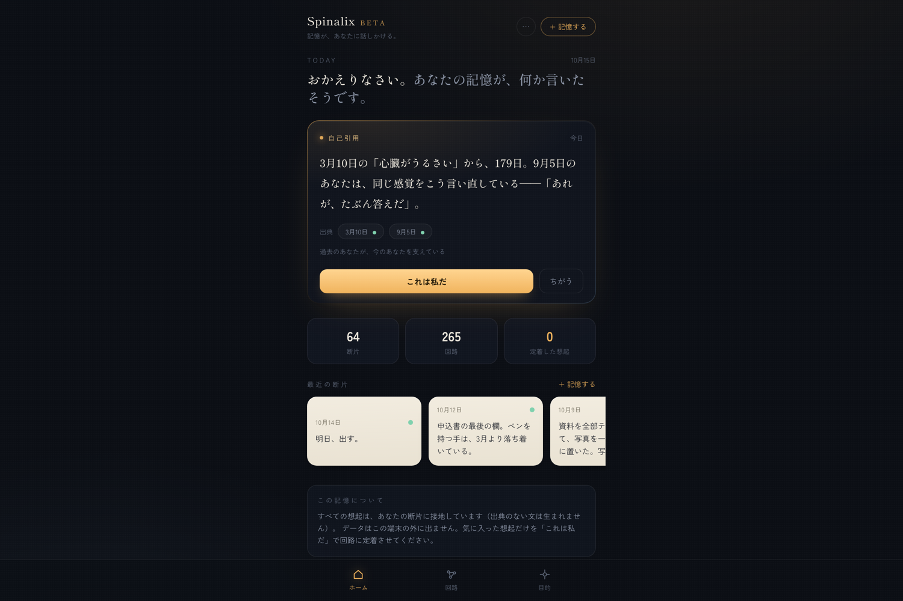
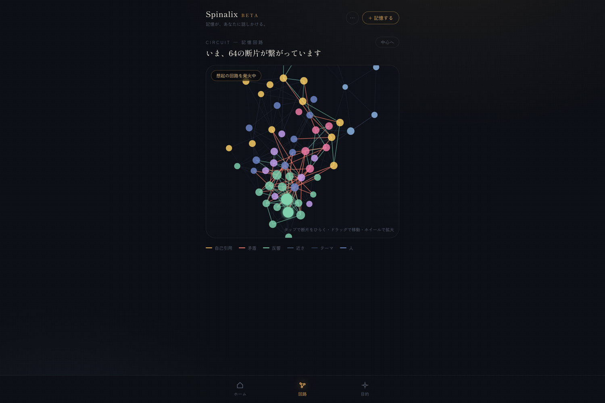
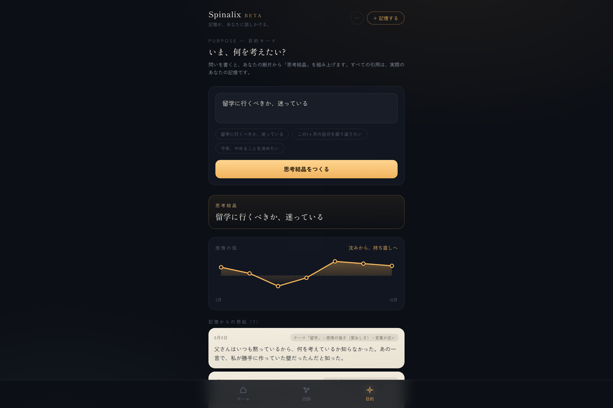
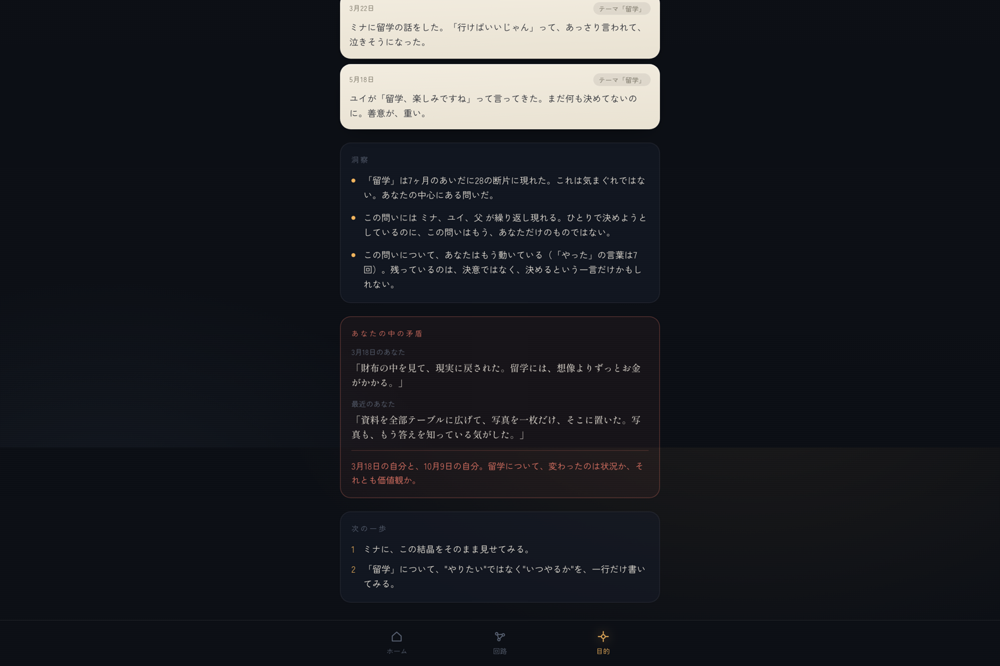
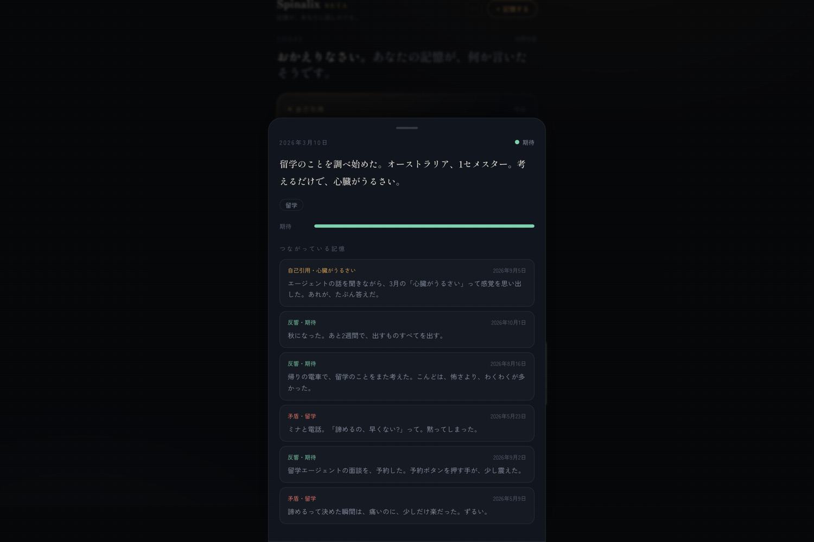
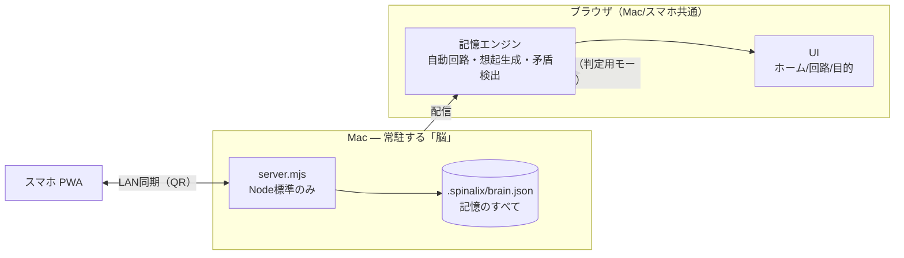

# Spinalix — 記憶が、あなたに話しかける

> 断片（感情つきの一行）を貯めると、AIが記憶回路を自動で組み、
> **あなたの中から「ふとした想起」を生成**して、決断や思考という具体的な成果物に変える、ローカル完結の思考脳。

**Next Founders Hackathon 2026 出品作品** / Built by Takumi Kawai

| | |
|---|---|
| 🌐 ライブデモ（審査員用・キー不要で動作） | https://takumi-kdev.github.io/spinalix/ |
| 🎬 5分動画 | （提出後リンク） |
| 🧠 Mac常駐モード | `npm install && npm run brain` → 出たQRをスマホで読む |

---

## スクリーンショット

| ホーム（想起） | 記憶回路 | 思考結晶 |
|---|---|---|
|  |  |  |

| 矛盾の指摘 | Mac常駐とスマホ接続 | 断片とつながり |
|---|---|---|
|  |  |  |

## これは何か

既存の「AIメモリー」は**保存と検索**です。Spinalixは一回り違います — **記憶をするAI**です。

- 検索は「問い」を必要とする。人間の想起は「問い」を必要としない。
- Spinalixは、あなたの断片と感情から**システム側から**想起を生み出します。
- すべての想起には**出典**（いつ・どの断片から生まれたか）が付きます。捏造はしません。
- あなたの矛盾（向きの違う二つの言葉）は、隠さず指摘します。忖度はしません。
- 記憶はローカル（ブラウザ、またはMac常駐のJSONファイル）に留まり、外部に送信されません。

## 60秒でわかる使い方

1. **ホーム**: 開いた瞬間、今日の「ふと」が届いています。
   - `自己引用` — 過去のあなたが、今のあなたを引用していることに気づく
   - `矛盾` — 5月の「諦めたほうがいい」と10月の「明日、出す。」が同居している
   - `反響` — 2月の期待と10月の覚悟が、同じ感情で鳴っている
2. **これは私だ / ちがう**: 選んだ想起だけが記憶回路に定着します。この採否から、生成の傾向が**学習**されます。
3. **回路**: 64断片・265本の回路。感情は色、回路は種類（自己引用/矛盾/反響/近さ/テーマ/人）を持ちます。
4. **目的モード**: 「留学に行くべきか、迷っている」と書くと、あなたの断片から**思考結晶**（出典付きの想起・感情の弧・洞察・矛盾・次の一歩）が組み上がります。

## このAIで「今までできなかったこと」

| できない | Spinalix |
|---|---|
| メモは貯まるが、二度と読み返さない | システム側から毎日、想起が届く（問いが不要） |
| AIの答えが抽象的で、自分ごとにならない | すべての文が**あなたの断片に接地**し、出典が表示される |
| 自分の矛盾や変化に気づけない | 感情の向きが反対の記憶を**矛盾**として提示する |
| 生きた感情がどこにも残らない | 感情を第一級データとして保存し、弧（推移）として見せる |
| 脳をクラウドに預ける不安 | ローカル完結。Mac常駐＋スマホ接続（同一Wi-Fi・QR） |

## アーキテクチャ（ローカル完結）



- **エンジン**は純関数の集合（`src/lib/engine.ts`）。同じ入力からは常に同じ想起が出ます（決定論的・テスト可能）。
- **感情モデル**は日本語語彙から推論（`src/lib/emotion.ts`）。外部APIは使いません。
- **同期**はMac常駐サーバーの `/api/state`（GET/PUT）。競合は最終更新優先。サーバーが無い環境ではブラウザ内保存に自動フォールバックします。
- **審査員向けデモ**はGitHub Pagesの静的版として動作し、8ヶ月分の記憶（架空ペルソナ+作者の実体験の一部）で全機能が動きます。

## 実行方法

```bash
npm install
npm run dev        # 開発（http://localhost:5173）
npm run brain      # ビルドしてMacに「脳」を常駐（QRでスマホ接続）
npm test           # エンジンの決定論的テスト
npm run check      # 型 + テスト + ビルド
```

## 設計原則（倫理）

1. **捏造しない** — 生成物は実在の断片に接地し、出典を必ず表示する。
2. **忖度しない** — 同意や励ましではなく、矛盾と見落としを提示する（anti-sycophancy）。
3. **依存させない** — 通知は1日2回まで。使わせ続けるための設計をしない。
4. **渡さない** — 感情データは端末の外に出さない。いつでもJSONで持ち出せる。

## ビジネス

- Free（ローカル完結） / **Pro ¥780/月**（同期・音声・深度・製本割引）
- 年間「記憶の本」製本 ¥4,800（StoryWorth型の実証済み収益）
- 詳細: [`business/BUSINESS-MODEL.md`](business/BUSINESS-MODEL.md) / [`business/financial-model.csv`](business/financial-model.csv)
- 参考市場: デジタル日記アプリ市場 $6.3–7.3B（2026, CAGR 10–11%）/ Rosebud（AI日記）は$6M調達・$12.99/月

## Built with

TypeScript / React / Vite / Tailwind CSS / d3-force / zustand / Node標準ライブラリ（サーバー）/ 自前の記憶エンジン（外部AI API不使用）

## AI利用の開示

コーディングエージェント（opencode / DeepSeek V4.1）を作業パートナーとして使用し、設計・実装・テストを進めました。プロダクト自体は外部AI APIに依存せず、端末内の決定論的エンジンで動作します。

## 制限（正直な開示）

[`docs/LIMITATIONS.md`](docs/LIMITATIONS.md) を参照。要約: 想起の生成はテンプレート合成であり、LLMによる文章生成は行いません（APIキー不要で誰でも動かせることとのトレードオフ）。デモの記憶は8ヶ月分のサンプルデータです。
