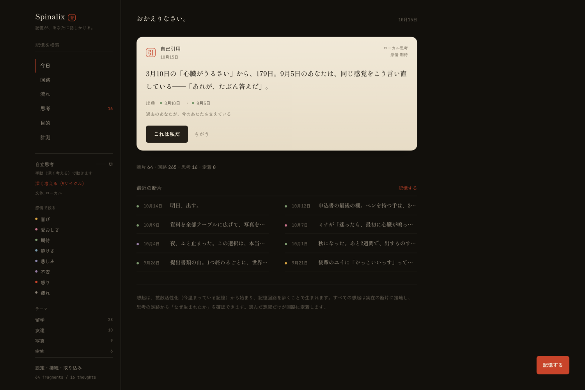
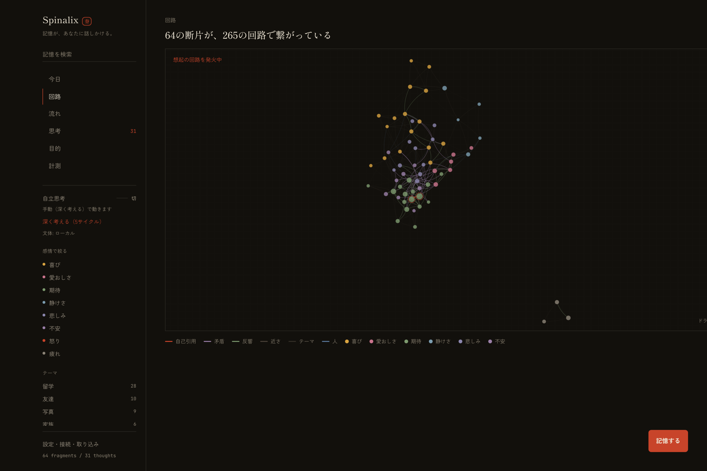
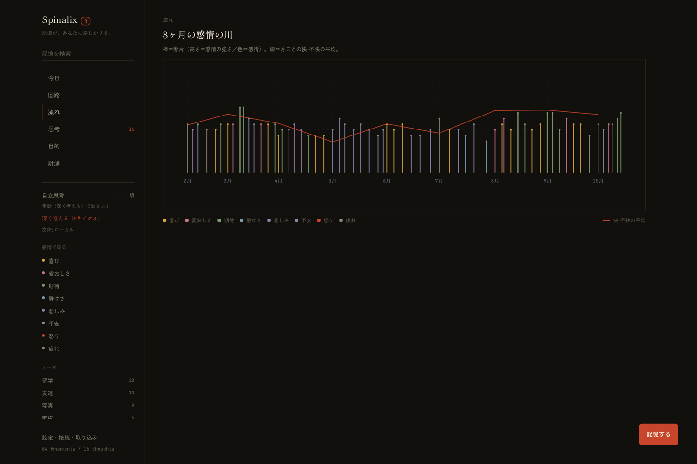
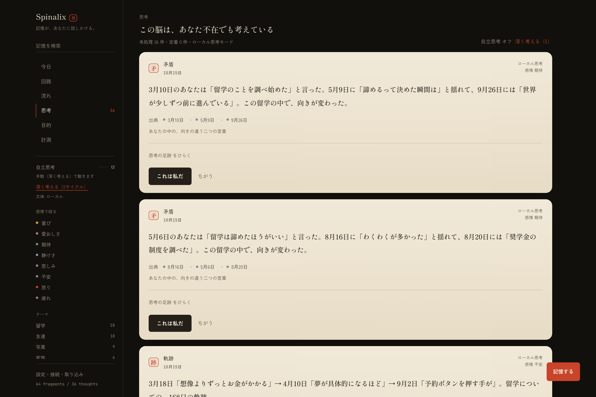
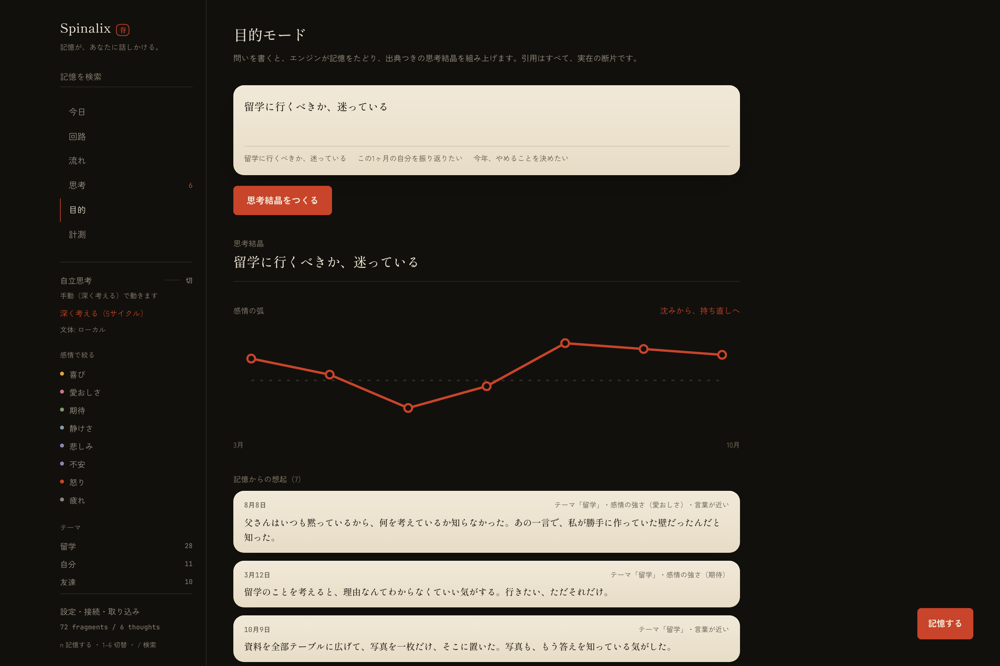
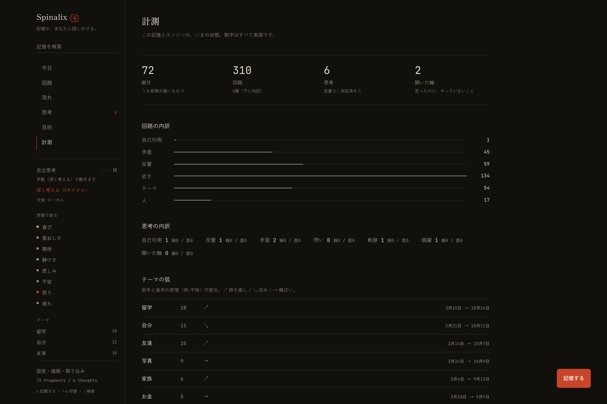
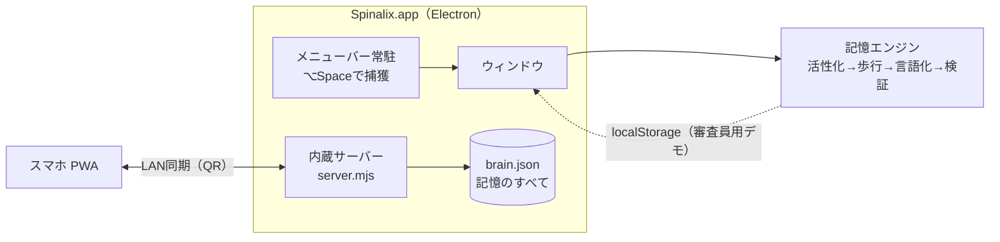

# Spinalix — 記憶が、あなたに話しかける

> 断片（感情つきの一行）を貯めると、**記憶エンジンが回路を組み、あなたの中から「ふと思い浮かぶ思考」を生成する**、ローカル完結の思考脳。
> 思考はエンジンが行い、AIは禁止 — 外部APIは「文体」だけを借り、記憶を捏造する権限を持たない。

**Next Founders Hackathon 2026 出品作品** / Built by Takumi Kawai

| | |
|---|---|
| 🖥 **デスクトップアプリ（Mac・ダウンロードして即利用）** | [Releases から `Spinalix.dmg` をダウンロード](../../releases/latest) |
| 🌐 プロダクトページ（デモは「デモを開く」から・キー不要） | https://takumi-kdev.github.io/spinalix/ |
| 🎬 5分動画（提出用・英語字幕入り） | YouTube限定公開（`submission/video/demo.mp4` をアップロード） |
| 🧠 開発者向け | `npm install && npm run brain`（QRでスマホ接続）/ `npm test` |

---

## スクリーンショット

| プロダクトページ |
|---|
|  |

| ホーム（想起の便箋） | 回路（記憶回路） | 流れ（感情の川） |
|---|---|---|
|  |  |  |

| 思考（自立思考の記録） | 目的（思考結晶） | 計測（システムの状態） |
|---|---|---|
|  |  |  |

## 審査員のための3分ツアー

1. **プロダクトページ** https://takumi-kdev.github.io/spinalix/ — 何を解くのか、エンジンの6工程と数式、位置づけ
2. **デモを開く**（同ページの朱のボタン）— 登録不要・キー不要。ブラウザ内だけで動きます
3. 最初の便箋で **「思考の足跡をひらく」** → **解剖** — 起点の活性値、検討した道筋、選ばれなかった候補まで見えます
4. 左の **計測** — 回路の内訳・テーマの弧・開いた輪・いま温まっている記憶10件
5. **思考** →「深く考える（5）」または**自立思考をオン** — エンジンが記憶を歩いて考え続けます
6. **目的** に「留学に行くべきか、迷っている」 — 出典つきの思考結晶（感情の弧・洞察・矛盾・次の一歩）

（ショートカット: `n` 記憶する / `1–6` 画面切替 / `/` 検索 / `Esc` 閉じる）

## これは何か

既存の「AIメモリー」は**保存と検索**です。Spinalixは**記憶をするAI**です。

- 検索は「問い」を必要とする。人間の想起は「問い」を必要としない。
- Spinalixは、**拡散活性化**（今、心の中で温まっている記憶）から始まり、**記憶回路を歩いて**（多ホップ探索）、想起を生成します。
- すべての想起には**思考の足跡**が付きます — 起点・拡散・跳躍のすべてを確認できます。捏造はしません。
- あなたの矛盾（向きの違う二つの言葉）と、**開いた輪**（言ったのに、やっていないこと）は、隠さず指摘します。
- 記憶はローカル（アプリのユーザーデータ / Mac常駐のJSON）に留まり、外部に送信されません。

## エンジン（この作品の核）

| 層 | 何をするか |
|---|---|
| **活性化** `activation.ts` | 感情の強さ × 忘却曲線 × 参照回数。直近の断片・強い感情・高活性の記憶が「今のあなた」の種になる |
| **回路** `engine.ts` | 6種のリンク（自己引用/矛盾/反響/近さ/テーマ/人）。種類ごとの上限つき「少数精鋭」設計 |
| **思考歩行** `walk.ts` | 記憶グラフのビーム探索。5つの歩き方（反すう・共鳴・対照・軌跡・跳躍）で多ホップの道筋を見つける |
| **分析** `analysis.ts` | テーマの弧・開いた輪（意志語 vs 行動語）・人プロフィール・問い・沈黙したテーマ |
| **言語化** `render.ts` | あなたの断片から「いちばん強い一節」を抽出し、道筋を文に組み上げる（抽出＋接続方式） |
| **検証** `verify.ts` | API出力の門番。引用の実在・日付の捏造・ありきたりな励ましを機械的に検査し、違反は破棄 |

### 自立思考モード

アプリを開いている間、24秒ごとにエンジンが記憶を歩き、思考が「思考の記録」に積まれていきます（「深く考える」で即時5サイクル）。**あなたが問いを立てなくても、脳は考えている**。

### API文体モード（新しい概念）

**AIに考えさせません。** エンジンが決定論的に組み上げた〈思考状態〉（道筋・感情・矛盾・制約）だけをAPIに渡し、LLMは日本語に整える「文体家」としてのみ働きます。返答は検証され、記憶にない引用・新しい日付・励ましの類は破棄、失敗時はローカル文に戻ります。→ **ありきたりなAI回答が構造的に混入できない。**

## 60秒でわかる使い方

1. **ホーム**: 開いた瞬間、今日の「ふと」が届いています（自己引用/矛盾/反響/軌跡/跳躍/開いた輪/問い）。
2. **思考の足跡**: なぜその想起が生まれたか（起点→拡散→跳躍）を展開して確認。
3. **これは私だ / ちがう**: 選んだ想起だけが回路に定着。採否から生成傾向が学習されます。
4. **回路**: d3-zoom/dragで滑らかに操作。想起の道筋が**光の粒として発火**します。
5. **流れ**: 8ヶ月の記憶を感情の川として見る（棒＝断片、線＝快-不快の平均）。
6. **目的モード**: 「留学に行くべきか、迷っている」→ 出典つきの思考結晶（感情の弧・洞察・矛盾・次の一歩）。
7. **Obsidian取り込み**: 設定からVault（フォルダ）を選ぶと、Markdownが断片として回路に組み込まれます。

## デスクトップアプリ

- **ダウンロードして普通に使えます**: Releases の `Spinalix.dmg` → ドラッグ＆ドロップでインストール。
- メニューバーに常駐。**どこからでも ⌥Space で「記憶する」**。
- 記憶は `~/Library/Application Support/spinalix/brain.json` にだけ保存。
- 同じWi-Fiのスマホからは設定画面の **QRコード** で同じ記憶に接続（Macは変わらずサーバーとして動きます）。

## アーキテクチャ



## 実行方法（開発）

```bash
npm install
npm run dev        # 開発サーバー
npm run brain      # Macに「脳」を常駐（QRでスマホ接続）
npm run app        # Electronアプリとして起動
npm run dist       # .dmg / .zip をビルド（release/）
npm test           # エンジンの決定論的テスト（17件）
npm run check      # 型 + テスト + ビルド
```

## 設計原則（倫理）

1. **捏造しない** — 生成物は実在の断片に接地し、思考の足跡を必ず表示する。
2. **忖度しない** — 同意や励ましではなく、矛盾と開いた輪を提示する（anti-sycophancy）。
3. **依存させない** — 通知は1日2回まで。使わせ続けるための設計をしない。
4. **渡さない** — 感情データは端末の外に出さない。いつでもJSONで持ち出せる。
5. **AIに考えさせない** — 思考はエンジン。AIには文体だけを許し、門番が検証する。

## ビジネス

- Free（ローカル完結） / **Pro ¥780/月**（同期・音声・深度・製本割引）
- 年間「記憶の本」製本 ¥4,800 / 詳細: [`business/BUSINESS-MODEL.md`](business/BUSINESS-MODEL.md)
- 参考市場: デジタル日記アプリ $6.3–7.3B（2026, CAGR 10–11%）/ Rosebud（AI日記）は$6M調達・$12.99/月

## Built with

TypeScript / React / Vite / Tailwind CSS / d3-force・d3-zoom / zustand / Electron / Node標準ライブラリ / 自前エンジン（通常時は外部AI API不使用）

## AI利用の開示

コーディングエージェント（opencode / DeepSeek V4.1）を作業パートナーとして使用し、設計・実装・テストを進めました。プロダクト自体はAPIキーなしで全機能が動きます（API文体モードは任意）。

## 制限（正直な開示）

[`docs/LIMITATIONS.md`](docs/LIMITATIONS.md) を参照。要約: 想起の文章は抽出＋接続方式（LLMの自由生成ではない）。デモの記憶は8ヶ月分のサンプル（架空ペルソナ+作者の実体験の一部）。
